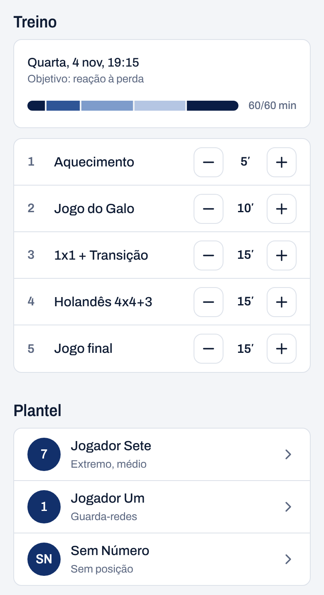
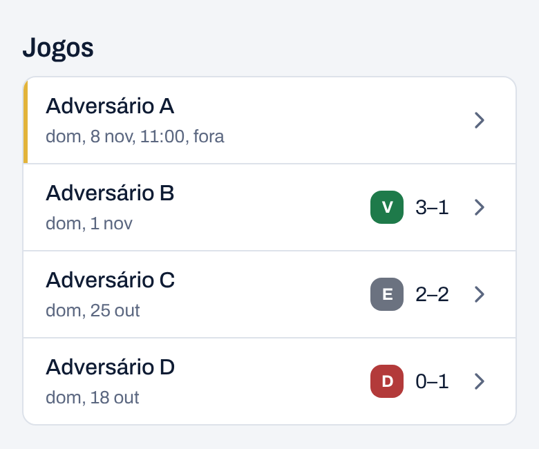
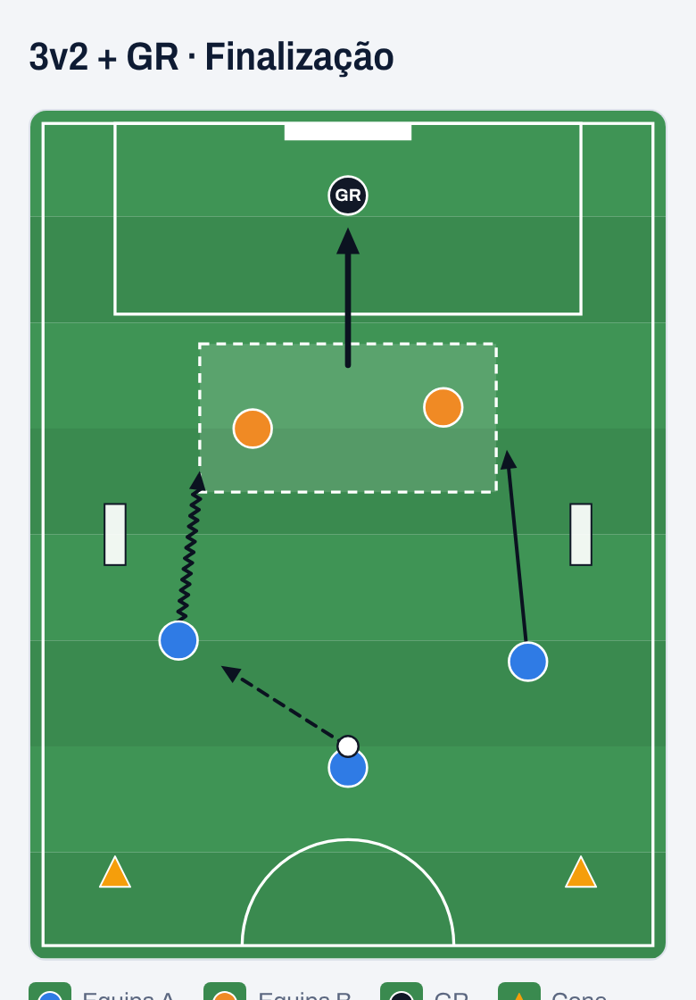
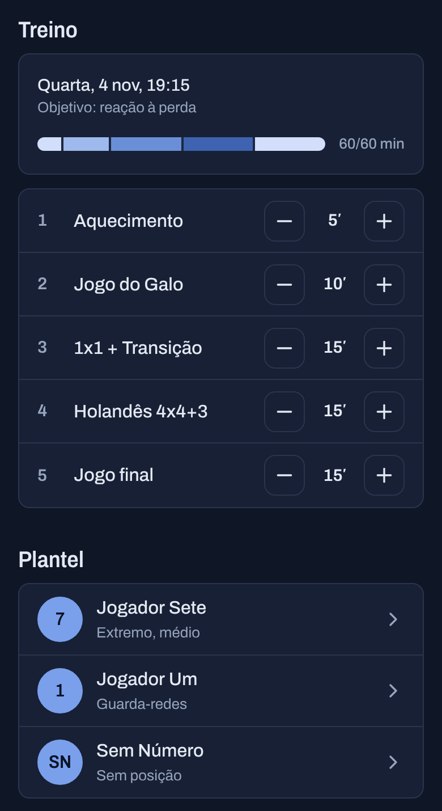
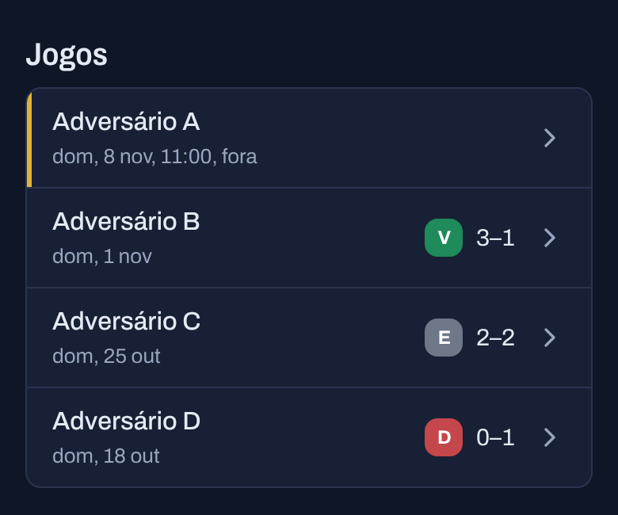
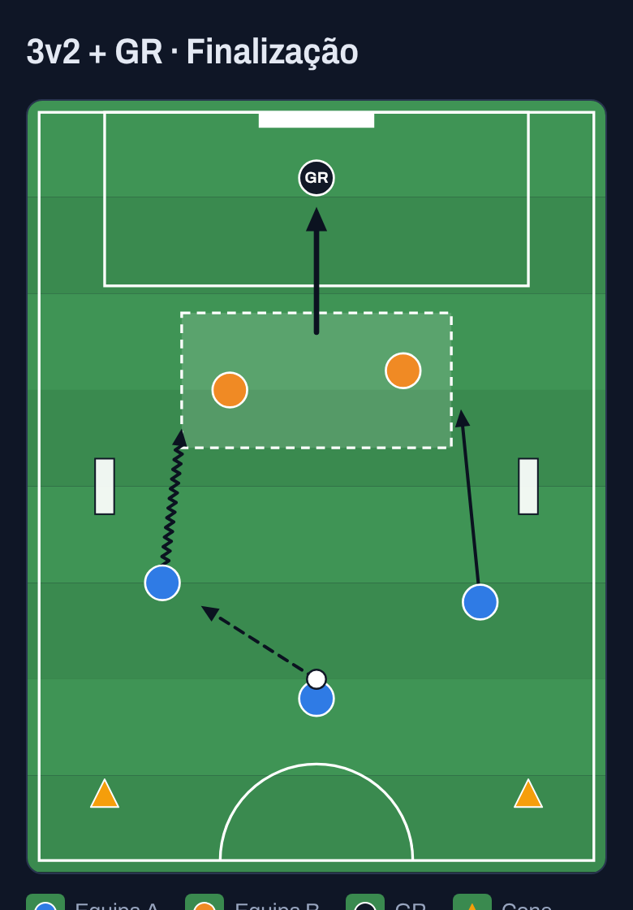

# Overlap

App web privada para a equipa técnica de uma equipa de futebol de formação (Sub-11, dois treinadores). Pensada para o **telemóvel, no campo, com pouca paciência**: cada ecrã tem de se perceber em dois segundos e usar-se com uma mão.

Plantel e observações, jogos e análise pós-jogo, biblioteca de exercícios com o campo desenhado, planeamento de treinos com barra de tempo. Modo claro e modo escuro.

> Os screenshots usam dados inventados. A app real tem dados de menores e o repositório é privado.

| Treino e plantel                                                                                                              | Jogos                                                                                        | Exercício (campo)                                                                                         |
| ----------------------------------------------------------------------------------------------------------------------------- | -------------------------------------------------------------------------------------------- | --------------------------------------------------------------------------------------------------------- |
|  |  |  |
|                                  |            |                 |

## O que tem de interessante

- **Editor de campo em SVG puro, sem bibliotecas.** O exercício guarda-se como JSON (`{ field, pieces, arrows, zones }`) validado com Zod, em coordenadas do campo. O mesmo componente desenha a miniatura da lista, a vista grande e o editor, que acrescenta eventos de ponteiro por cima (arrastar, rodar mini-balizas em qualquer ângulo, setas de passe, desmarcação, condução e remate, desfazer). Ver `src/features/exercises`.
- **Barra de tempo do treino.** Um segmento por exercício, proporcional aos minutos, contra a duração alvo. Funções puras com testes (`src/features/training/minutes.ts`).
- **Isolamento por equipa na base de dados, não só na app.** Row Level Security em todas as tabelas e chaves estrangeiras compostas `(team_id, id)`, para que um registo de uma equipa nunca possa apontar para outro de outra equipa. Bucket de imagens privado com URLs assinados de 1 h. Ver `docs/DATABASE.md`.
- **Next.js 16 com Cache Components.** O shell das páginas é estático e os dados chegam por streaming dentro de `<Suspense>`. Server Actions seguem sempre a mesma ordem (validar, autenticar, escrever, refrescar) e devolvem um `ActionResult` tipado, sem lançar erros esperados para o cliente.
- **Tema sem flash.** Automático (segue o telemóvel), claro ou escuro; um script no `<head>` aplica o tema antes da primeira pintura. Os componentes só usam tokens de cor.
- **Backup semanal cifrado** da base de dados (GitHub Actions, `pg_dump` + `gpg`), porque o plano gratuito do Supabase não faz backups.
- **Feito para o telemóvel:** alvos de toque de 44 px, inputs de 16 px (sem zoom no iOS), formulários em gavetas inferiores, instalável no ecrã principal.

## Stack

Next.js 16 (App Router), TypeScript estrito, Tailwind CSS v4, Radix/Vaul (componentes ao estilo shadcn/ui), Supabase (Postgres, Auth, Storage) via `@supabase/ssr`, Zod, Vitest, Vercel. Fonte Archivo variável, servida pelo próprio site.

## Correr

```bash
cp .env.example .env.local   # URL e chave publishable do projeto Supabase
npm install
npm run dev                  # http://localhost:3000
npm run lint
npm run typecheck
npm run test
npm run build
```

O schema está em `supabase/migrations/` (fonte da verdade) e os testes de RLS em `supabase/tests/rls_smoke.sql`. Só existem no cliente a URL e a chave publishable; a chave secreta nunca entra no código.

## Documentação

`docs/PRD.md` (produto), `docs/DESIGN.md` (visual), `docs/DATABASE.md` (dados, segurança e backups), `docs/ROADMAP.md` (tarefas). Contexto para agentes de AI: `AGENTS.md`.
