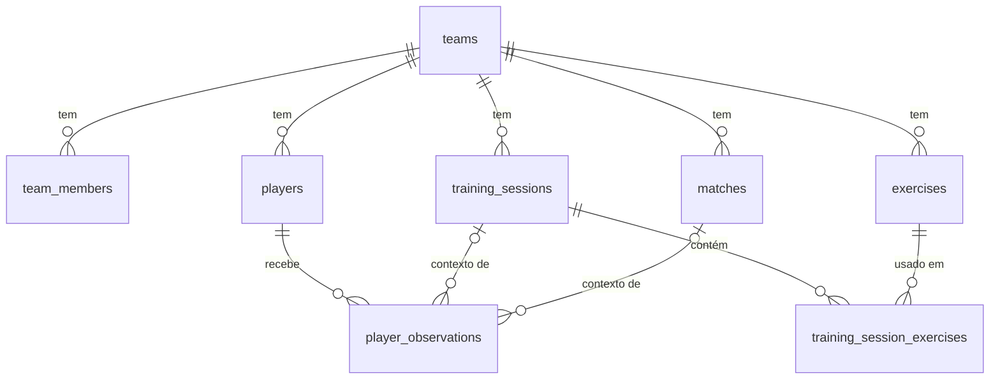

# Overlap — Base de dados

**Fonte da verdade:** os ficheiros em `supabase/migrations/`. Este documento explica o porquê.

- Schema do MVP: `supabase/migrations/0001_initial_schema.sql`
- Criar equipa e membros (uma vez): `supabase/bootstrap.sql`
- Teste de segurança: `supabase/tests/rls_smoke.sql`

A migração 0001 foi testada em Postgres 16 com 23 testes de isolamento e integridade, todos a passar.

## Modelo



| Tabela                       | O que guarda                         | Notas                                                                                                                                                                                                                              |
| ---------------------------- | ------------------------------------ | ---------------------------------------------------------------------------------------------------------------------------------------------------------------------------------------------------------------------------------- |
| `teams`                      | Espaço de trabalho da equipa técnica | Persiste entre épocas                                                                                                                                                                                                              |
| `team_members`               | Quem tem acesso e com que papel      | Gerida só pelo dashboard                                                                                                                                                                                                           |
| `players`                    | Ficha do jogador                     | `is_active = false` para arquivar                                                                                                                                                                                                  |
| `player_observations`        | Texto livre sobre um jogador         | Ligação opcional a um treino ou jogo                                                                                                                                                                                               |
| `exercises`                  | Biblioteca                           | `tags` é um array de enum; arquiva-se, não se apaga. `diagram` (jsonb) guarda o campo desenhado; `series`, `rest_seconds` e `success_criteria` vieram na 0002. `max_players`, `organization` e `coaching_points` já não são usados |
| `training_sessions`          | Um treino                            | `status`: planeado, realizado ou cancelado                                                                                                                                                                                         |
| `training_session_exercises` | Itens ordenados de um treino         | Da biblioteca ou livres                                                                                                                                                                                                            |
| `matches`                    | Jogo + resultado + análise           | Resultado `null` = ainda não jogado                                                                                                                                                                                                |

## Decisões de modelação (e os problemas que evitam)

1. **`team_id` em todas as tabelas.** A RLS fica numa linha por política, sem joins, e acrescentar outra equipa ou utilizador não obriga a mudar o schema.

2. **Chaves estrangeiras compostas `(id, team_id)`.** Uma observação de um jogador da equipa A não pode ficar marcada como sendo da equipa B. É a base de dados que o garante, não o código.

3. **Duração e notas ficam no item do treino, não no exercício.** Editar o "Jogo do Galo" na biblioteca não reescreve os treinos passados.

4. **Itens livres:** `exercise_id = null` + `custom_title`. Não obriga a criar na biblioteca o "Jogo final".

5. **Arquivar em vez de apagar** jogadores e exercícios. Um exercício usado num treino nem sequer pode ser apagado (FK `tse_exercise_fk`).
   - A FK é `deferrable`, para que apagar uma equipa inteira funcione.
   - A app mostra "Arquivar" e nunca "Apagar" para exercícios.

6. **Apagar um treino ou jogo não apaga observações.** Só se perde a ligação (`on delete set null (coluna)`).

7. **Época derivada da data** (julho a junho). Não há tabela de épocas no MVP. Na época seguinte, arquivam-se os miúdos que saem e a biblioteca continua.

8. **Listas fixas como enum** (posições, etiquetas, estado, tipo de jogo). São simples e validadas pela BD.
   - Nova etiqueta: `alter type public.exercise_tag add value 'x';` numa migração nova.
   - Os nomes que aparecem na UI vivem num mapa em `src/features/exercises/labels.ts`.

9. **Só o ano de nascimento,** nunca a data completa. Fica a idade sem dados a mais.

10. **Ficaram de fora de propósito:** `MatchEvents`, objetivos e as tabelas do quadro tático. Entram com uma migração própria quando saírem do stand-by.

## Segurança (RLS)

Há duas funções de autorização, ambas `security definer` para não haver recursão na RLS de `team_members`:

- `is_team_member(team_id)`: o utilizador pertence à equipa.
- `can_edit_team(team_id)`: pertence à equipa com papel `owner` ou `coach`.

| Papel                         | Ler                | Criar / editar / apagar |
| ----------------------------- | ------------------ | ----------------------- |
| `owner`, `coach`              | ✓                  | ✓                       |
| `staff` (futuro Sr. Fernando) | ✓                  | ✗                       |
| Autenticado sem equipa        | ✗                  | ✗                       |
| Anónimo                       | ✗ (sem permissões) | ✗                       |

Regras extra:

- `teams` e `team_members` não têm escrita a partir da app. Só se mexem pelo dashboard/SQL.
- Ao criar uma observação, `author_id` tem de ser o utilizador autenticado. Ninguém escreve em nome de outro.
- `reorder_session_items(session_id, ids[])` é `security invoker`, por isso a RLS aplica-se.

**Storage:** bucket privado `team-media`, com limite de 2 MB por ficheiro e só imagens.

- Caminhos: `{team_id}/players/{player_id}/{uuid}.webp` e `{team_id}/exercises/{exercise_id}/{uuid}.webp`.
- As políticas leem o `team_id` do primeiro segmento do caminho. Um caminho mal formado é negado.
- As colunas `photo_path` e `image_path` têm um `check` que obriga o caminho a começar pelo `team_id` da linha.
- As imagens mostram-se com URLs assinados criados no servidor (validade de 1 hora). Nunca `getPublicUrl`.

## Como mudar o schema (passo a passo)

1. Criar `supabase/migrations/000N_descricao.sql`. **Nunca editar uma migração já aplicada.**
2. Tabela nova: `team_id` + FK composta se for filha + `enable row level security` + 4 políticas (ver as existentes).
   - O acesso de `anon` a tabelas novas já nasce revogado.
   - O de `authenticated` existe, por isso **sem RLS ativa a tabela fica aberta a qualquer conta**.
3. Correr no SQL Editor e depois `supabase/tests/rls_smoke.sql`. Para uma tabela nova, acrescentá-la à lista do teste B.
4. `npm run db:types` para regenerar `src/types/database.ts`.
5. Atualizar este documento se mudou alguma decisão.

## Arranque (uma vez)

1. Supabase → novo projeto numa região da UE.
2. Authentication → Sign In / Providers: desligar **"Allow new users to sign up"**. Email + password ligado.
3. SQL Editor → colar e correr `0001_initial_schema.sql`.
4. Authentication → Users → **Add user** → Create new user (com "Auto Confirm User" ligado).
5. SQL Editor → colar `bootstrap.sql`, trocar o email pelo da conta e correr. Não fazer commit da versão com emails.
6. SQL Editor → `tests/rls_smoke.sql`. Esperado: `PASS A`, `PASS B`, `PASS C`.

## Backups

O plano grátis não faz backups. O `.github/workflows/backup.yml` faz um todos os domingos (e quando o corres à mão em Actions → Backup semanal → Run workflow).

- Guarda a base de dados (`public` + contas de `auth.users`), cifrada com AES-256, como artifact privado durante 30 dias.
- **Não guarda as fotos/imagens do Storage.**
- Secrets necessários: `SUPABASE_DB_URL` (connection string do **Session pooler**, porque a ligação direta é IPv6 e o GitHub não lá chega) e `BACKUP_PASSPHRASE`. Guarda a passphrase fora do GitHub.

**Restaurar** (testado localmente: dados, políticas e RLS voltam):

```bash
gpg -d backup-AAAA-MM-DD.tar.gpg > backup.tar && tar -xf backup.tar && cd backup-AAAA-MM-DD
# num projeto Supabase novo (public vazio), com a connection string do pooler em $DB:
pg_restore -d "$DB" --data-only auth-users.dump     # 1. contas (mantém os UUIDs)
pg_restore -d "$DB" --no-owner public.dump          # 2. schema + dados da app
# 3. no SQL Editor: correr só a secção 12 (Storage) da 0001_initial_schema.sql
```

Faz o restauro uma vez num projeto de teste. Um backup que nunca foi restaurado não conta.
